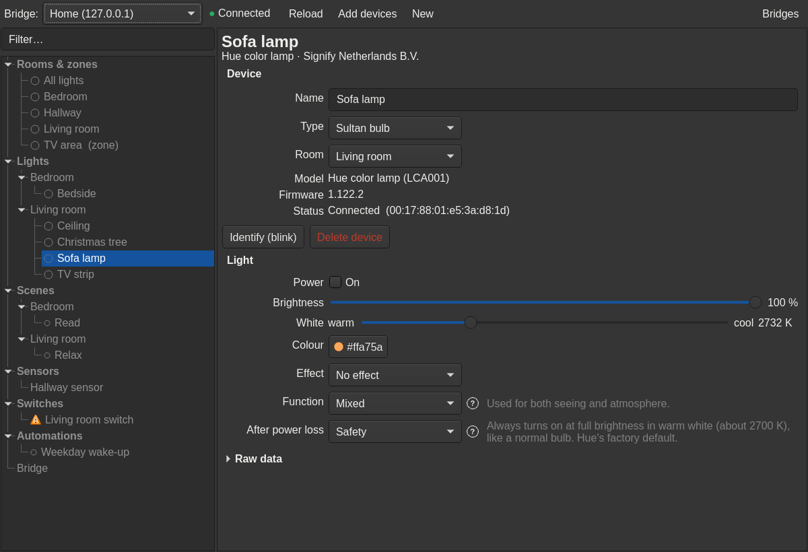
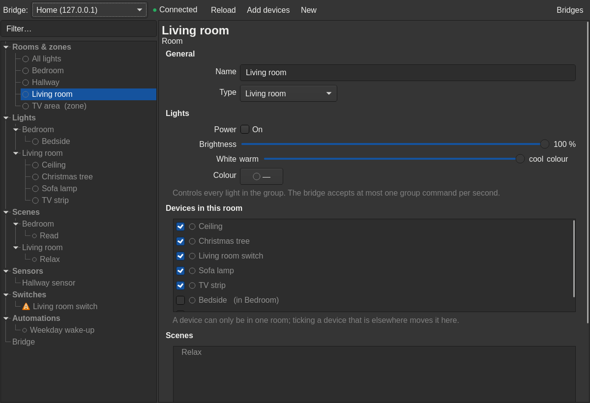
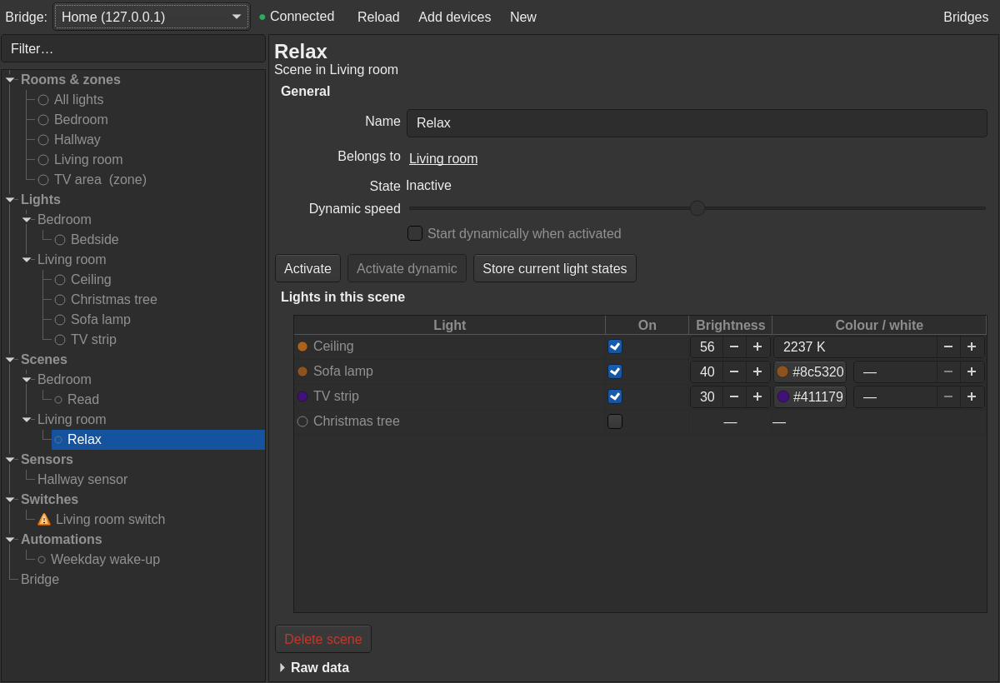

# Hueman

A desktop app for managing **Philips Hue Bridges** on your local network. It's built on Python and Qt 6
(PySide6) and talks directly to the bridge's local CLIP v2 API, with no cloud and no account.

Browse every room, light, scene, sensor, switch and automation in one tree, edit them in place, and watch
changes made elsewhere (the Hue app, wall switches, motion sensors) appear live.

## Clanker generated 🤖

I did not write this application by myself - I just wanted a quick little tool to help me migrate my Philips Hue lights from their Hue Bridge to my Zigbee controller and the original mobile app is a PITA with mandatory updates.

So I Googled a bit and found no apps that would enable me to iterate over already paired devices & command them. I did not really want to curl the API and I my GUI design abilities are non-existant. So I fired up Claude & told it to whip up a quick app exactly for this purpose.

This is the result - and I'm putting it up if someone has a similar problem to solve. Nothing more, nothing less. Feel free to do whatever you want with the app - if there is a bug, please do a PR. I will probably not spend too much time taking care updating this since I will be getting rid of my Hue Bridge.




<table>
  <tr>
    <td></td>
    <td></td>
  </tr>
</table>

## Features

- **Multiple bridges.** Pair as many bridges as you like, found via mDNS or added by IP address, and switch
  between them from the toolbar. Only one is connected at a time.
- **Everything in one tree.** Rooms and zones, lights grouped by room, scenes grouped by room, sensors,
  switches, other devices and automations, with a filter box. Coloured dots show each light's current state;
  warning icons flag unreachable devices and low batteries.
- **Changes apply immediately.** There's no Save button: every change is sent to the bridge as you make it.
  Slider drags are rate-limited to the bridge's documented limits (about 10 commands/s per light, 1/s per
  room or zone).
- **Live updates** through the bridge's event stream. Changes from the Hue app, switches and sensors show up
  as they happen.
- **Lights:** on/off, brightness, white colour temperature, colour, effects, fixture type, light function,
  and behaviour after a power loss (with explanations of each option), plus *Identify* (blink).
- **Devices:** rename, move between rooms, add new Zigbee devices (with optional serial numbers), delete.
- **Rooms & zones:** create, rename, delete, choose members, control all their lights at once.
- **Scenes:** activate, rename, delete, edit each light's settings, or store the current light states as a
  new or existing scene.
- **Sensors:** enable/disable, motion sensitivity, live motion, temperature and light-level readings.
- **Automations:** enable/disable, rename, create, delete, and edit the configuration as JSON.
- **Pinned TLS.** The bridge's self-signed certificate is pinned (SHA-256) on first contact. If it ever
  changes, Hueman refuses to connect until you confirm the new one.

Deleting anything asks for confirmation first. Nothing else does.

## Requirements

- Python 3.10 or newer (developed on 3.14)
- PySide6 6.5 or newer (developed on 6.11)
- `requests`, `zeroconf`
- A Philips Hue Bridge v2 (the square one) with up-to-date firmware, on the same network

Hueman is developed and tested on Linux. Qt and the Python libraries it uses are cross-platform, so
Windows and macOS should work, but they haven't been tried.

## Installation

```sh
git clone <this repository> hueman
cd hueman
python3 -m venv .venv
.venv/bin/pip install -r requirements.txt
```

If your distribution already ships PySide6, `python3 -m venv --system-site-packages .venv` lets the
virtualenv reuse it instead of downloading Qt again.

## Usage

```sh
./hueman.sh                 # or: .venv/bin/python -m hueman
```

On first start, the **Bridges** window opens and searches your network. Pick your bridge (or type its IP
address), click **Pair…**, and press the round link button on top of the bridge within 60 seconds.
That's it. The bridge shows up in the toolbar's drop-down, and Hueman reconnects to it on the next start.

To add new lights or accessories, use **Add devices…** in the toolbar. To add another bridge, open
**Bridges…** again.

### Where settings are stored

Paired bridges, their application keys and pinned certificate fingerprints are stored in
`~/.config/hueman/bridges.json`, readable only by you (mode 600). Set `HUEMAN_CONFIG_DIR` to use a
different directory. Removing a bridge in Hueman only deletes it from this file; the bridge itself is not
changed.

## Project status

This is an early release. Reading everything from a bridge has been tested against a real bridge
(BSB002, API 1.77). **Every operation that changes something** (light control, pairing, deleting,
editing rooms, scenes and automations) has been tested against the bundled mock bridge, not against real
hardware. Bug reports from real setups are very welcome.

Not supported (yet): editing smart-scene schedules, switch button mappings, entertainment areas, and the
older v1 rules and schedules that previous Hue app versions left on many bridges.

## Development

```sh
.venv/bin/pip install -r requirements-dev.txt
.venv/bin/python -m pytest tests        # runs entirely against the mock bridge
.venv/bin/python -m pyflakes hueman tests tools
```

The tests start the app's real main window in a headless Qt (`QT_QPA_PLATFORM=offscreen`) and drive it
against `tools/mock_bridge.py`, a fake bridge that implements the parts of the CLIP v2 API Hueman uses:

- HTTPS with a self-signed certificate
- `POST /api` pairing, including the link button
- resource GET / PUT / POST / DELETE
- the server-sent event stream
- Zigbee device discovery that "finds" a new lamp

You can also run it on its own and point Hueman at it, to try things without touching your real lights:

```sh
tools/mock_bridge.py --port 8443                    # a small demo home; pairing is accepted automatically
tools/mock_bridge.py --manual-link                  # require: curl -k -X POST https://127.0.0.1:8443/mock/press-link
tools/mock_bridge.py --snapshot my-bridge.json      # seed it from a real bridge's GET /clip/v2/resource
```

Then add `127.0.0.1:8443` as a bridge in Hueman.

### Code layout

```
hueman/api.py          blocking CLIP v2 client, certificate pinning, event-stream parsing
hueman/session.py      one bridge connection: initial load, event thread, ordered and throttled writes
hueman/store.py        in-memory copy of the bridge's resources, updated from events (Qt signals)
hueman/discovery.py    mDNS discovery (_hue._tcp)
hueman/ui/             main window, navigation tree, detail pages, dialogs
tools/mock_bridge.py   fake bridge for tests and manual testing
tests/                 pytest + pytest-qt
```

API reference: the [Hue CLIP API v2 documentation](https://developers.meethue.com/develop/hue-api-v2/)
on the Philips Hue developer site (free account required).

## License

Hueman is released into the public domain under [the Unlicense](https://unlicense.org).
Do whatever you like with it. See [LICENSE](LICENSE).

## Disclaimer

Hueman is an independent project and is not affiliated with, endorsed by, or sponsored by Signify or
Philips. Philips and Philips Hue are trademarks of their respective owners.
